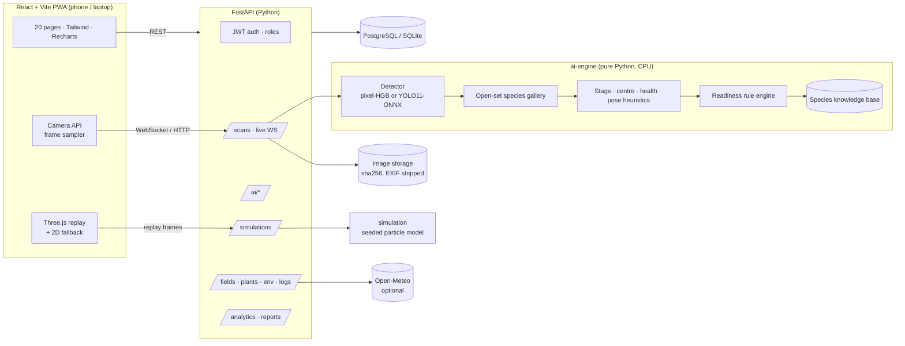
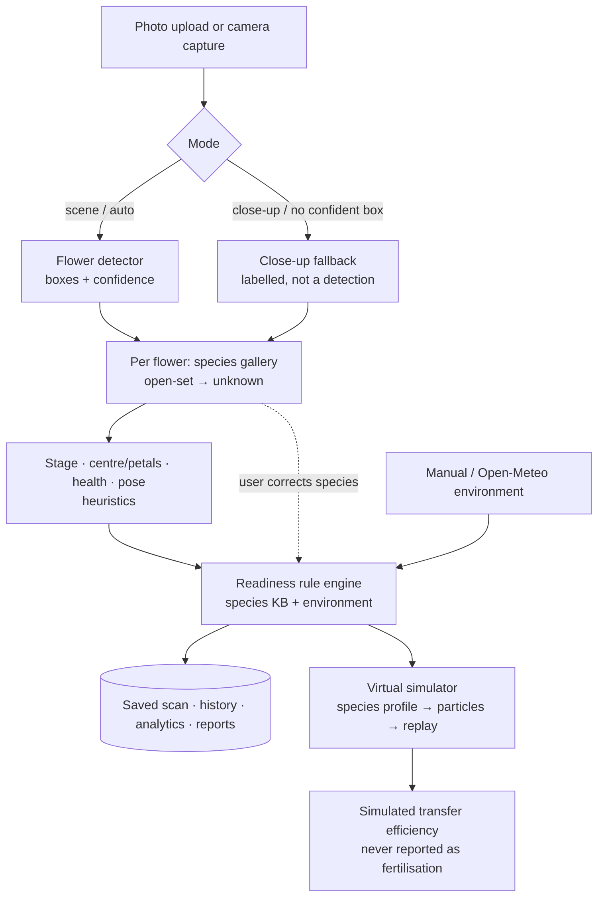

# POLLINEX AI

### Intelligent multi-species flower analysis, pollination-readiness estimation and virtual pollination simulation

[](.github/workflows/ci.yml)
 
 

POLLINEX AI is a **software-only** research platform that runs on a laptop and a phone browser. It detects flowers in photos and
live camera frames, recognises species with an **open-set** reference gallery, estimates visible developmental stage, inspects the
flower centre and visible health, and turns **species-specific pollination biology** into explainable, uncertainty-aware
recommendations. A **Three.js simulator** replays seeded particle simulations of pollen transfer.

> **Honesty first.** Every output in the API, UI and reports is tagged with how it was produced —
> `trained_model`, `trained_reference_gallery`, `heuristic`, `rule_engine`, `simulation`, `closeup_fallback`, `user_declared`
> or `user_corrected`.
> Readiness is a *visual estimate*, simulated transfer is *not* fruit set, and no metric shown anywhere is a placeholder.

> **Status (2026-11-03):** built, started and tested. On every push, GitHub Actions installs the real packages on clean
> Ubuntu **and Windows** runners and runs 86 automated tests (37 AI/simulator, 24 backend, 11 frontend unit, 14 Playwright E2E
> incl. camera), type-check, production build, migrations on PostgreSQL 16 + SQLite, backend startup, Docker builds and a
> Docker Compose smoke test — all green ([CI run #41626877962](https://github.com/nvaltryek-001/pollinex-ai/actions/runs/41626877962)).
> Not done: public cloud deployment, YOLO11 training, labelled data for anther/stigma and for 6 of the 9 crops.
> Full report: [`docs/PROJECT_COMPLETION_REPORT.md`](docs/PROJECT_COMPLETION_REPORT.md).

---

## Contents
1. [Objectives](#objectives) · 2. [What was built](#what-was-built) · 3. [Measured results](#measured-results) ·
4. [Architecture & workflow](#architecture) · 5. [Simulator](#virtual-pollination-simulator) · 6. [Tech stack](#technology-stack) ·
7. [Windows installation](#windows-installation-recommended) · 8. [Quick start (Linux/macOS/Docker)](#quick-start) · 9. [Testing](#testing) ·
10. [Deployment](#deployment) · 11. [Usage](#usage) · 12. [API](#api) · 13. [Datasets & credits](#datasets--credits) ·
14. [Research](#research) · 15. [Limitations](#limitations-read-this) · 16. [Future scope](#future-scope) ·
17. [Project audit](#project-audit) · 18. [Repository layout](#repository-layout)

## Objectives
1. Detect and count flowers in ordinary photos and phone-camera frames, with calibrated confidence.
2. Recognise species across an extensible set of crops and say **unknown** when unsure; let users correct it.
3. Describe what is visible (stage, centre region, health cues, image-space pose) without over-claiming.
4. Turn species-specific pollination biology into explainable, uncertainty-aware decision support.
5. Let users explore pollen transfer in a virtual, clearly-labelled simulation.
6. Keep everything reproducible, measured on held-out data, and runnable on a laptop with no hardware.

## What was built

| Area | What it does | Evidence type |
|---|---|---|
| **Flower detection** (Module 1) | Pixel classifier (gradient-boosted trees on a 36-channel colour/texture stack) → probability map → instances → boxes, scores, count, low-confidence warnings. Trained **in this repo** on CPU. Optional YOLO11 ONNX backend is auto-used when its file exists. | trained model |
| **Species recognition** (Module 2) | kNN reference gallery with an open-set threshold calibrated on validation; returns `unknown` instead of forcing a class; **manual correction** per flower (original prediction kept, readiness re-estimated); researchers can add reference images for new species without retraining. | trained reference gallery / user corrected |
| **Flower centre / structures** (Module 3) | Petal region and distinct centre region + pollen-like yellow cluster. Per-structure status table: anther, stigma, stamen, pistil = **not AI-validated** (no licensed annotations exist) — CVAT workflow + training recipe provided. | heuristic |
| **Maturity stage** (Module 4) | Bud / early bloom / partially open / fully open / senescent from shape & colour cues. | heuristic |
| **Readiness intelligence** (Module 5 + Part 6) | Rule engine over a 9-species knowledge base (mechanism, compatibility, ready stages, env. ranges, evidence, limitations). Different strategies per crop: vibration (tomato, brinjal), compatible cross-pollen (apple, pear), brush/contact (chilli, peach, hibiscus), air-assisted (strawberry), ring progression (sunflower). | rule engine |
| **Pose & approach guidance** (Module 6) | Image-space centre, facing ratio, axis angle and alignment vector to a virtual effector (explicitly *not* metric). | heuristic |
| **Visual health** (Module 7) | Browning, dark spots, discolouration, outline irregularity — measurements only, never a disease name. | heuristic |
| **Evaluation** (Module 8) | COCO-style mAP@0.5 / 0.5:0.95, P/R/F1, per-species, AP-vs-IoU, count error, pixel IoU, latency, confusion matrix, leave-one-species-out, error analysis. | measured |
| **Live scanner** | Upload, phone/laptop camera (permission handling, camera switching), capture & analyse, **sampled** live inference over WebSocket (HTTP fallback) with back-pressure and an adjustable interval. | — |
| **Virtual simulator** | Seeded 3-D particle model per species profile; Three.js replay with species-specific structures, particle trails, orbit, play/pause/replay, scrubbing, 0.25–4× speed; 2-D canvas fallback; sensitivity sweeps (alignment, wind, vibration Hz). | simulation |
| **Environment** | Manual records + Open-Meteo fetch (conditions, source + timestamp stored; explicit error if unavailable — never invented); missing- and stale-data warnings feed the readiness confidence. | — |
| **Web app** | 20 pages: landing, auth, dashboard, scanner, species, structure, maturity, readiness, simulator, environment, health, fields, inventory, pollination history, model evaluation, analytics, research centre, reports, datasets, admin. Dark/light themes, mobile-first. | — |
| **Platform** | FastAPI + SQLAlchemy 2 + Alembic, JWT auth with admin / researcher / user roles, token revocation on logout, PBKDF2 passwords, upload validation (type, size, decompression bombs, EXIF/GPS stripping), CSV/PDF/JSON reports, audit log, rate limiting, toast notifications, Docker Compose (PostgreSQL), CI workflow, Windows PowerShell scripts. | — |

## Measured results

These are the **historical results of the session-1 training run** (2026-11-02), stored in `ai-engine/reports/*.json`;
re-running the scripts regenerates them. All numbers come from those reports,, produced by the training scripts on a **held-out test split that was used once**
(parameters chosen on validation). Hardware: 2 vCPU cloud VM, no GPU.

**Data:** USDA Multi-species Fruit Flower dataset (apple, peach, pear) — 90 usable images, 4,651 mask-derived instances,
group-aware contiguous splits **54 / 14 / 22** images, 0 near-duplicates across splits.

### Flower detector — baseline & ablation (test split, same protocol)

| Variant | val mAP50 | **test mAP50** | test mAP50-95 | Precision | Recall | Pixel IoU | ms / image* |
|---|---|---|---|---|---|---|---|
| A · Otsu "whiteness" threshold (no learning) | 0.110 | 0.127 | 0.062 | 0.046 | 0.451 | 0.072 | 11 |
| B · boosted trees, 12 colour features | 0.276 | 0.240 | 0.109 | 0.059 | 0.593 | 0.149 | 4,664 |
| C · boosted trees, full 36 features | 0.491 | 0.405 | 0.186 | 0.167 | 0.626 | 0.371 | 9,569 |
| **C · deployed config (1280 px, stride 2)** | **0.506** | **0.410** | **0.191** | 0.169 | 0.610 | — | **1,990** |
| C · live-scan config (800 px, stride 2) | 0.384 | 0.305 | 0.129 | 0.215 | 0.439 | — | 676 |

\*per image on the 2-vCPU build machine. Configs were selected on **validation** with rules fixed beforehand.
Per-species test mAP50: apple 0.395 · peach 0.491 · pear 0.420 (stride-1 run). Recall rises with object size
(small < 16 px: 0.47 · medium: 0.64 · large > 40 px: 0.75).

**Interpretation:** a modest CPU baseline, far below deep detectors reported in the literature (we make no comparison claim).
Precision is low because pale bark and unlabelled background blossoms produce false positives (see the error analysis and
`ai-engine/reports/figures/`). The YOLO11 recipe is included to replace it once PyTorch is available.

### Species gallery (open-set, test split)

| Metric | Value |
|---|---|
| Open-set accuracy over {apple, peach, pear, unknown} | 0.819 (macro-F1 0.799) |
| Accuracy on flower crops only | 0.931 |
| Background crops rejected as `unknown` | 0.468 |
| Leave-one-species-out → returned `unknown` | apple 0.435 · peach 0.919 · pear 0.219 |

**Caveat:** each species in this dataset comes from a different camera setup, so species is confounded with capture conditions.
These numbers validate the *mechanism* (gallery + open-set rejection), not field-general species recognition. The other six
target crops have no evaluated references yet and return `unknown` unless the user declares the species or researchers add references.

### What was *not* measured
Stage, centre-region, health and pose heuristics (no labels exist), readiness rules (no biological ground truth), the
simulator (no physical trial), YOLO11 (not trainable in the build environment), and anything about fertilisation or yield.

## Architecture



More detail: [`docs/ARCHITECTURE.md`](docs/ARCHITECTURE.md) · [`docs/DATABASE_SCHEMA.md`](docs/DATABASE_SCHEMA.md).

### Workflow



## Virtual pollination simulator
A seeded particle model (Python) computes release, drift, wind, turbulence and capture; the browser replays it in Three.js
(or a 2-D canvas fallback). Species profiles: **tomato/brinjal** vibration of a poricidal anther cone (release peaks near
150–200 Hz) · **apple/pear** cross-transfer from a separate compatible donor flower · **chilli/peach** brush/contact ·
**strawberry** air-assisted coverage of ~60 pistils on the receptacle · **sunflower** pollen-presenting and receptive floret rings ·
**hibiscus** staminal column with five stigma pads. Controls: particles, release rate, alignment offset, wind, humidity, vibration
Hz, seed, play/pause/replay, timeline, 0.25–4× speed, parameter sweeps. Results separate *detection*, *simulation completion*,
*simulated transfer efficiency* and *biological outcome (not measured)*. Details and assumptions:
[`docs/SIMULATOR_DOCUMENTATION.md`](docs/SIMULATOR_DOCUMENTATION.md).

## Technology stack

| Layer | Choice | Why |
|---|---|---|
| Frontend | React 18, Vite 5, TypeScript, Tailwind 3, Recharts, Three.js, lucide-react | Spec stack; small bundle; mobile-first |
| Backend | FastAPI, Pydantic 2, SQLAlchemy 2, Alembic, PyJWT, WebSocket | Typed REST + OpenAPI docs + live channel |
| AI runtime | NumPy, SciPy, OpenCV, scikit-learn, scikit-image, onnxruntime (optional) | **No PyTorch needed to run** → works on any laptop CPU |
| AI training (optional) | Ultralytics YOLO11 + PyTorch → ONNX | Deep detector path (AGPL-3.0, see docs) |
| Database | PostgreSQL 16 (Docker/prod), SQLite (local dev) | Zero-setup dev, real DB in prod |
| Reports | ReportLab (PDF), CSV, JSON | Offline |
| Tests | Pytest, Vitest + Testing Library, Playwright | Unit → E2E |
| Deploy | Docker, Docker Compose, Render blueprint, Vercel config, GitHub Actions | |

## Windows installation (recommended)

Requirements: Windows 10/11, **Python 3.12** (python.org installer, tick *Add python.exe to PATH*), **Node.js 20 LTS+**, Git.
No GPU, no paid API, no hardware.

```powershell
git clone https://github.com/nvaltryek-001/pollinex-ai.git
cd pollinex-ai
powershell -ExecutionPolicy Bypass -File scripts\setup_windows.ps1      # venv, pip, npm, .env with random JWT secret
powershell -ExecutionPolicy Bypass -File scripts\run_windows.ps1        # API :8000 + web :5173, opens the browser
powershell -ExecutionPolicy Bypass -File scripts\test_windows.ps1       # all test suites + production build
```

**Database:** SQLite by default (zero setup, `backend\pollinex.db`). For PostgreSQL install it (or `docker run -p 5432:5432
-e POSTGRES_USER=pollinex -e POSTGRES_PASSWORD=... -e POSTGRES_DB=pollinex postgres:16`) and run
`scripts\setup_windows.ps1 -Postgres -PgPassword "..."` — it writes `DATABASE_URL` and applies the Alembic migrations.

**Manual steps (if you prefer):**
```powershell
python -m venv .venv; .venv\Scripts\activate; pip install -r backend\requirements.txt
cd backend; uvicorn app.main:app --reload            # backend → http://localhost:8000/docs
cd frontend; npm install; npm run dev                # frontend (second terminal) → http://localhost:5173
```
Register the first account — it becomes **admin**.

## Quick start

**Requirements:** Python 3.11+, Node 20+ (or Docker). No GPU, no paid API.

### Option A — local development
```bash
git clone https://github.com/<you>/pollinex-ai.git && cd pollinex-ai
scripts/setup_dev.sh          # venv + pip install + npm install + .env
scripts/run_dev.sh            # API on :8000, web app on :5173
```
Open http://localhost:5173, register (the **first account becomes admin**), and open the **Flower scanner**.
Try `tests/fixtures/sample_orchard.jpg` (a CC-BY test image from the dataset).
Swagger UI: http://localhost:8000/docs

Windows (PowerShell): `python -m venv .venv; .venv\Scripts\activate; pip install -r backend\requirements.txt`, then
`cd backend; uvicorn app.main:app --reload` and in another terminal `cd frontend; npm install; npm run dev`.

### Option B — Docker Compose (PostgreSQL)
```bash
cp .env.example .env     # set POSTGRES_PASSWORD and JWT_SECRET
docker compose up --build
# web: http://localhost:8080   api docs: http://localhost:8000/docs
```

### Using the phone camera
Browsers only allow the camera on **HTTPS** or `localhost`. On a LAN, serve the frontend over HTTPS (e.g. `mkcert` +
Vite `server.https`, or a tunnel such as `cloudflared`), or deploy (Vercel + Render). Image upload works everywhere,
and on phones the upload button can open the camera directly. Details: [`docs/USER_MANUAL.md`](docs/USER_MANUAL.md).

### Reproduce the models
```bash
SRC=/path/to/clone/of/multi-species-fruit-flower scripts/reproduce_models.sh
```

## Testing

| Command | Runs |
|---|---|
| `scripts\test_windows.ps1` / `scripts/run_tests.sh` | pytest (AI engine, simulator, backend API), Alembic migration, TypeScript check, Vitest, production build |
| add `-E2E` / `E2E=1` | + Playwright (desktop Chrome + Pixel 7, Chromium fake camera) |
| `python scripts/check_dependencies.py` | verifies Python/Node packages, model files, sklearn compatibility, DB connection |
| GitHub Actions (`.github/workflows/ci.yml`) | everything above on Ubuntu + Windows, PostgreSQL migrations, backend startup, Docker build + Compose smoke test |

**Reproducible installs:** `backend/requirements.lock.txt` and `frontend/package-lock.json` are the exact versions resolved and
tested in CI; `setup_windows.ps1` uses them automatically (`-NoLock` to use version ranges instead).
Results: [`docs/TESTING_REPORT.md`](docs/TESTING_REPORT.md).

## Deployment

| Target | How | Free-tier notes |
|---|---|---|
| Local, full stack | `docker compose up --build` (PostgreSQL + API + nginx web on :8080) | — |
| API | Render blueprint `deployment/render.yaml` (Docker) | free web services sleep when idle and have ~512 MB RAM; the CPU models fit (~300 MB) but first requests after sleep are slow and full analyses take seconds |
| Database | Render PostgreSQL (in the blueprint) or Neon / Supabase free tier | free Render databases expire after a limited period; back up |
| Web | Vercel (`frontend/`, `VITE_API_URL` = API URL) | static hosting; HTTPS gives phone-camera access |

Health check: `GET /api/v1/health`. Details: [`docs/DEPLOYMENT_GUIDE.md`](docs/DEPLOYMENT_GUIDE.md). The app is fully usable
locally without any cloud deployment. **No public deployment exists yet**; Docker Compose is verified in CI.

## Usage

1. **Scan** — upload or use the camera. Choose *auto* (orchard scene, falls back to close-up if nothing confident is found),
   *scene* or *close-up*; optionally declare the species, link a plant and an environment record.
2. **Read the result** — boxes over the image (solid = confident, dashed amber = low confidence, dashed red = close-up
   fallback), then per-flower species, stage, centre, health, pose and the readiness card with strategy, observations,
   uncertainty, limitations and sources.
3. **Simulate** — open the simulator from a readiness card; adjust alignment, wind, vibration frequency; compare runs.
4. **Record** — log real pollination actions and their observed outcome; add fields, plants and weather records.
5. **Analyse & export** — dashboard, analytics (admins/researchers can see all accounts), PDF / CSV / JSON reports.

## API

Interactive OpenAPI docs at `/docs`. Main groups (all under `/api/v1`):

| Group | Endpoints |
|---|---|
| Auth | `POST /auth/register` · `POST /auth/login` · `POST /auth/logout` · `GET /auth/me` |
| Scanning | `POST /scans` (upload + analyse) · `GET /scans` · `GET /scans/{id}` · `GET /scans/{id}/image` · `DELETE /scans/{id}` · `POST /scans/live/frame` · `WS /scans/live/ws` |
| AI modules | `POST /ai/detect` · `/ai/analyze` · `/ai/classify-species` · `/ai/structure` · `/ai/maturity` · `/ai/health` · `/ai/readiness` · `GET /ai/species` · `POST /ai/species/{id}/references` |
| Simulation | `POST /simulations` · `POST /simulations/{id}/execute` · `GET /simulations/{id}` · `GET /simulations/{id}/replay` · `POST /simulations/sweep` |
| Records | `/fields` · `/plants` · `/environment` · `POST /environment/fetch` · `/environment/{id}/assessment` · `/pollination-records` |
| Analytics & reports | `GET /analytics/dashboard` · `/analytics/species` · `/analytics/model-performance` · `/reports/scans.csv` · `/reports/summary.pdf` · `/reports/scans/{id}.json` |
| Admin | `/admin/users` · `/admin/activity` · `/admin/models` · `POST /admin/models/reload` · `/datasets` · `/research/references` · `/health` |

Full reference: [`docs/API_DOCUMENTATION.md`](docs/API_DOCUMENTATION.md).

## Datasets & credits

| Dataset | Status | Licence | Use |
|---|---|---|---|
| **Multi-species Fruit Flower** — Dias, Tabb & Medeiros (2018), USDA Ag Data Commons, doi:10.15482/USDA.ADC/1423466 | **integrated** | CC BY 4.0 | detector training/evaluation; species gallery |
| TensorFlow Flower Detection (INESC TEC, Zenodo 7768292) | script provided | CC BY 4.0 | future YOLO11 training on close-ups |
| Oxford 102 Flowers (Nilsback & Zisserman 2008) | script provided | terms unverified | species gallery only (sunflower, hibiscus) |
| FlowerNet (Mendeley 26nvt3t27m v2) | script provided (originals only) | MIT | hibiscus gallery; 5,600 augmented copies excluded to avoid leakage |
| EWD wildflowers · DoPI · FloPE · PlantCLEF | documented, not ingested | CC BY-NC / none / n.a. / unverified | methodology only (reasons in manifest) |

**Data audit finding:** the mirror's per-image bounding boxes are inconsistently oriented (often vertically flipped) relative to
the images and masks, so POLLINEX derives instances from the masks instead. See `datasets/reports/usda_fruit_flower_report.md`.
Full manifest: [`datasets/dataset_manifest.csv`](datasets/dataset_manifest.csv) · [`docs/DATASET_DOCUMENTATION.md`](docs/DATASET_DOCUMENTATION.md).
No image archives or large weights are committed — download scripts rebuild everything.

## Research

Literature review of FloPE (IROS 2025), Broussard et al. (Agronomy 2023), Zhang et al. (Comput. Electron. Agric. 2025),
Singh et al. (AI Review 2025), Schouten et al. (PLOS ONE 2024) and DoPI (Ecology 2022), plus the dataset paper and
detection/segmentation references. Five research gaps and how the software responds are documented in
[`research/`](research/) (`literature_review.md`, `research_comparison.md`, `research_gaps.md`, `methodology.md`, `references.bib`).
Our contributions are engineering contributions; no external paper's results are claimed as ours.

## Limitations (read this)

* **Detector** is trained only on apple/peach/pear orchard photos; it confuses pale bark with petals and misses many small
  flowers (test precision 0.17, recall 0.61). On close-ups of other crops the app falls back to whole-image analysis and says so.
* **Species** evaluation is confounded with camera setup; six of nine crops have no evaluated references.
* **No anther/stigma detection.** Structure, stage, health and pose are heuristics, not trained models.
* **Readiness** is a rule-based *visual* estimate from general horticultural knowledge; not validated against receptivity or fertilisation.
* **Simulation** models geometry and simple physics only; parameters (e.g. canopy wind attenuation 0.02, carry fraction 0.75) are assumptions.
* **Environment rules** are general ranges; verify locally.
* **Licensing:** Ultralytics YOLO11 is AGPL-3.0 — only relevant if you train/ship the optional deep detector.

## Future scope
* Train YOLO11 (Colab guide in `docs/AI_MODEL_DOCUMENTATION.md`) and compare with the CPU baseline on the same test split.
* Collect and annotate (CVAT) images of the six crops without public data; add held-out tests; train stage and structure models.
* Replace the hand-crafted species embedding with a pretrained backbone exported to ONNX.
* Field trials following the randomised block design in `research/methodology.md` to validate readiness timing.
* Offline-capable PWA and on-device inference for low-connectivity fields.

## Screenshots
Captured automatically by Playwright from the running application in CI (desktop Chrome and Pixel 7 emulation) — not mock-ups.

| Scanner results (real detections, provenance badges) | 3-D virtual pollination simulator |
|---|---|
|  |  |
| **Model evaluation (saved test-split metrics)** | **Dashboard** |
|  |  |
| **Species knowledge base & recognition** | **Mobile scanner (Pixel 7 profile)** |
|  |  |

All 20 captures: [`docs/screenshots/`](docs/screenshots/).

## Project audit

| Item | Status |
|---|---|
| Research review, gaps, methodology, references | ✅ (some volume/article numbers marked unverified) |
| Dataset manifest, licences, prep scripts, leakage audit | ✅ USDA set integrated; other sources script-only (documented) |
| Flower detector trained & evaluated | ✅ test mAP@0.5 0.410 (historical session-1 run) |
| Species gallery, open-set `unknown`, manual correction | ✅ tested (backend + E2E) |
| Stage / structures / health / pose | ✅ labelled heuristics · ⚠️ not accuracy-evaluated (no labels) |
| Anther / stigma / stamen / pistil detection | ❌ no labelled data — reported as *not AI-validated*; CVAT workflow provided |
| YOLO11 | ⚠️ recipe, ONNX backend, Colab guide; not trained |
| Readiness engine + environment intelligence | ✅ tested |
| Simulator engine + 3-D/2-D UI | ✅ tested (engine + E2E) |
| Backend, PostgreSQL, migrations, auth, roles, reports | ✅ tested in CI |
| Frontend 20 pages, camera, live scan | ✅ type-checked, built, unit + E2E tested (fake camera) |
| Windows scripts | ✅ verified on windows-latest |
| Docker / Compose | ✅ built + smoke-tested in CI |
| Public deployment | ❌ not deployed (configs ready) |
| Physical phone test | ⚠️ manual step (emulation + fake camera automated) |

Details: [`docs/PROJECT_COMPLETION_REPORT.md`](docs/PROJECT_COMPLETION_REPORT.md) · [`docs/TESTING_REPORT.md`](docs/TESTING_REPORT.md) ·
[`docs/PROJECT_COMPLETION_AUDIT.md`](docs/PROJECT_COMPLETION_AUDIT.md).

## Repository layout

```
frontend/      React + Vite + TS app (pages/, components/, lib/, e2e/)
backend/       FastAPI app (routers/, services/, models.py), Alembic migrations, tests
ai-engine/     pollinex_ai package (detector, species, maturity, structure, health, pose, readiness, knowledge base),
               training/ scripts, models/ (small shipped models), reports/ (evaluation JSON + figures), tests
simulation/    pollinex_sim particle engine + tests
datasets/      manifest, sources, licences, prep/download scripts, annotation workflow, splits, COCO annotations, reports
research/      literature review, comparison, gaps, methodology, references (.bib/.json)
docs/          architecture, schema, API, models, datasets, methodology, install, deploy, testing, manual, final report
deployment/    Render blueprint (Vercel config lives in frontend/)
scripts/       setup / run / test / reproduce helpers (bash + Windows PowerShell)
tests/         shared fixtures (CC BY test images)
```

## Licence

Code: MIT (see `LICENSE`). Training data and the fixture images: CC BY 4.0, © Dias, Tabb & Medeiros — please cite
doi:10.15482/USDA.ADC/1423466 and doi:10.1109/LRA.2018.2849498 if you use the trained models.
