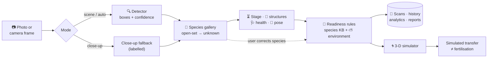
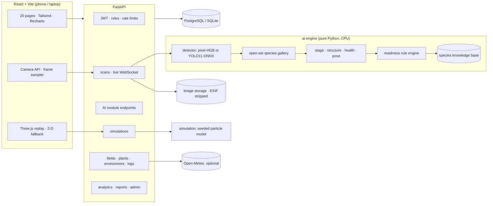

<div align="center">


<br>

[](https://github.com/nvaltryek-001/pollinex-ai/actions/workflows/ci.yml)


**Point a phone at a flower. Pollinex detects it, recognises the species (or honestly says _unknown_), reads its visible<br>
stage and health, explains whether it looks ready for pollination — and lets you simulate pollen transfer in 3-D.**

[Quick start](#-quick-start) ·
[Screenshots](#-screenshots) ·
[Features](#-features) ·
[How it works](#-how-it-works) ·
[Results](#-measured-results) ·
[Testing](#-testing--verification) ·
[Docs](#-documentation)

</div>

---

## 🌼 Why Pollinex?

Pollination decides yield, but the right method differs by crop: tomato needs **vibration**, apple and pear need **compatible
cross-pollen**, strawberry needs **every pistil covered**. Research systems that address this usually need robots, drones or
3-D rigs. Pollinex is the software-only counterpart: it runs on a **laptop and a phone browser**, uses public datasets and real
trained models, and **labels where every answer comes from** — so nothing looks more certain than it is.

<table>
<tr>
<td width="33%" valign="top">

### 📷 See
Upload or scan live with a laptop / phone camera. Flowers are detected with boxes and confidence; low-confidence results are
flagged, never hidden.

</td>
<td width="33%" valign="top">

### 🧠 Understand
Open-set species recognition, visible stage, flower centre, health cues and species-specific readiness — each tagged
**trained model**, **heuristic** or **rule engine**.

</td>
<td width="33%" valign="top">

### 🌀 Simulate
A seeded 3-D particle simulation of pollen release, drift and capture per crop — clearly a **computation**, never a claim of
fertilisation.

</td>
</tr>
</table>

---

## 📸 Screenshots

<sub>Captured automatically by Playwright from the running application in CI — real output, not mock-ups.</sub>

<table>
<tr>
<td width="62%" valign="top"></td>
<td width="38%" valign="top"></td>
</tr>
<tr>
<td align="center"><b>Scanner</b> — 86 flowers detected, per-flower species, stage, readiness and provenance badges</td>
<td align="center"><b>Mobile</b> — same scanner on a Pixel 7 profile</td>
</tr>
</table>

<table>
<tr>
<td width="50%" valign="top"></td>
<td width="50%" valign="top"></td>
</tr>
<tr>
<td align="center"><b>Virtual simulator</b> — strawberry receptacle with many pistil targets</td>
<td align="center"><b>Model evaluation</b> — saved held-out test metrics, baseline &amp; ablation</td>
</tr>
<tr>
<td width="50%" valign="top"></td>
<td width="50%" valign="top"></td>
</tr>
<tr>
<td align="center"><b>Species recognition</b> — 9-crop knowledge base with evidence</td>
<td align="center"><b>Dashboard</b> — metrics from real database records only</td>
</tr>
</table>

<details>
<summary><b>More screenshots</b> (landing, readiness, analytics, datasets, research — desktop &amp; mobile)</summary>
<br>

| | |
|---|---|
|  |  |
|  |  |
|  |  |

All 20 captures live in [`docs/screenshots/`](docs/screenshots/).
</details>

---

## ✨ Features

| | Module | What it does | Evidence |
|:-:|---|---|:-:|
| 🔍 | **Flower detection** | Boxes, confidence, counts and low-confidence warnings from a YOLO11n detector trained in this repo (ONNX, runs on CPU). The original pixel model is kept as an MIT fallback. | `trained model` |
| 🌸 | **Species recognition** | Open-set reference gallery: says **unknown** below a calibrated threshold. One-click **manual correction** (original prediction kept, readiness re-estimated). Researchers add references for new species without retraining. | `reference gallery` |
| ⏳ | **Maturity stage** | Bud · early bloom · partially open · fully open · senescent, with score distribution and an *uncertain* flag. | `heuristic` |
| 🔬 | **Flower structures** | Petal and centre regions, pollen-like cluster. Anther, stigma, stamen and pistil shown as **not AI-validated** (no labelled data exists yet). | `heuristic` |
| 🩺 | **Visual health** | Browning, spots, discolouration, irregular outline — measurements only, **never a disease name**. | `heuristic` |
| 🎯 | **Pollination readiness** | Species-specific rules: strategy, supporting observations, confidence, uncertainty, biological limits and sources. | `rule engine` |
| 🧭 | **Pose & approach** | Image-space centre, facing estimate and alignment vector (explicitly *not* real-world distance). | `heuristic` |
| 🌀 | **3-D simulator** | Six species modes, particles with trails, play / pause / replay / speed, alignment & wind sweeps, 2-D fallback. | `simulation` |
| ⛅ | **Environment** | Manual records or Open-Meteo (conditions, source, timestamp); missing/stale-data warnings lower confidence. | — |
| 📱 | **Live scanner** | Laptop & phone cameras, permission handling, camera switching, sampled live inference with back-pressure, capture & save. | — |
| 📊 | **Analytics & reports** | Dashboard, trends, simulation history, model performance; PDF, CSV and JSON downloads. | — |
| 🔐 | **Platform** | JWT auth, **admin / researcher / user** roles, rate limiting, audit log, secure uploads (EXIF/GPS stripped), dark & light themes. | — |

<details>
<summary><b>All 20 pages</b></summary>
<br>

Landing · Sign in / Register · Dashboard · Flower scanner · Species recognition · Flower structure · Maturity stages ·
Pollination readiness · Plant health · Virtual simulator · Environment · Field management · Flower inventory · Pollination history ·
Model evaluation · Analytics · Research centre · Datasets · Reports · Admin settings
</details>

### 🌱 Supported crops

| Crop | Pollination strategy in the knowledge base | Simulator mode | Dataset images in repo | Detector | Species gallery |
|---|---|---|--:|:-:|:-:|
| 🍅 Tomato | vibration of poricidal anthers (buzz-like) | `vibration` | 200 | ⚠️ no boxes (unvalidated) | ✅ |
| 🍆 Brinjal | vibration; long/medium-styled flowers set best | `vibration` | 20 | ⚠️ no boxes | ❌ too few images |
| 🌶️ Chilli | brushing / gentle shaking | `brush` | 28 | ⚠️ no boxes | ❌ too few images |
| 🍎 Apple | compatible cross-cultivar pollen | `cross_transfer` | 155 | ✅ YOLO11 | ✅ |
| 🍐 Pear | compatible cross-cultivar pollen | `cross_transfer` | 47 | ✅ YOLO11 | ✅ |
| 🍑 Peach | mostly self-fertile; brush supplement | `brush` | 95 | ✅ YOLO11 | ✅ |
| 🍓 Strawberry | even coverage of all pistils | `air_assisted` | 15 | ⚠️ no boxes | ❌ too few images |
| 🌻 Sunflower | ring-by-ring floret progression | `ring_progression` | 828 | ✅ YOLO11 | ✅ |
| 🌺 Hibiscus | pollen onto five stigma pads | `column_transfer` | 91 | ⚠️ no boxes (unvalidated) | ✅ |

> **Verified 2026-11-03** ([final release report](docs/FINAL_RELEASE_REPORT.md)): 1,479 real images. 718 have flower boxes
> (USDA + sunflower). 761 are iNaturalist photos with species labels only (CC0 / CC BY / CC BY-SA), and these are never used as boxes.
> The species gallery enables a crop only if it passes a validation gate that was fixed before any results existed. **Strawberry, brinjal and chilli did not pass**:
> they have too few openly licensed photos. No anther, stigma, stamen or pistil annotations exist for any crop.
> Crops without references return **unknown** until reference images are added — or the user selects the species.
> New crops are added with one JSON entry + reference photos; no code changes.

---

## 🚀 Quick start

### Windows (recommended)

> Needs **Python 3.12** ([python.org](https://www.python.org/downloads/), tick *Add python.exe to PATH*), **Node.js 20+**, **Git**.
> No GPU, no paid API, no hardware.

```powershell
git clone https://github.com/nvaltryek-001/pollinex-ai.git
cd pollinex-ai
powershell -ExecutionPolicy Bypass -File scripts\setup_windows.ps1    # venv, pinned packages, npm, .env, dependency check
powershell -ExecutionPolicy Bypass -File scripts\run_windows.ps1      # API :8000 + app :5173, opens your browser
```

Open **http://localhost:5173**, register (the **first account becomes admin**) and go to **Flower scanner**.
Try `tests/fixtures/sample_orchard.jpg`. API docs: **http://localhost:8000/docs**.

<details>
<summary><b>Linux / macOS</b></summary>

```bash
git clone https://github.com/nvaltryek-001/pollinex-ai.git && cd pollinex-ai
scripts/setup_dev.sh        # venv + pip + npm + .env
scripts/run_dev.sh          # API :8000, app :5173
```
</details>

<details>
<summary><b>Docker Compose (PostgreSQL)</b></summary>

```bash
cp .env.example .env        # set POSTGRES_PASSWORD and JWT_SECRET
docker compose up --build   # app http://localhost:8080 · API http://localhost:8000/docs
```
</details>

<details>
<summary><b>PostgreSQL on Windows</b></summary>

```powershell
# local PostgreSQL (or: docker run -p 5432:5432 -e POSTGRES_USER=pollinex -e POSTGRES_PASSWORD=... -e POSTGRES_DB=pollinex postgres:16)
powershell -ExecutionPolicy Bypass -File scripts\setup_windows.ps1 -Postgres -PgPassword "your-password"
```
Writes `DATABASE_URL` to `.env` and applies the Alembic migrations. Without it, SQLite (`backend\pollinex.db`) is used.
</details>

<details>
<summary><b>📱 Using your phone's camera</b></summary>

Browsers only allow the camera on **HTTPS** (or `localhost`). Start the app, then expose it with a tunnel:

```powershell
cloudflared tunnel --url http://localhost:5173
```
Open the `https://…trycloudflare.com` address on your phone. Image upload works everywhere, and on phones the upload button
can open the camera directly.
</details>

<details>
<summary><b>Manual commands (no scripts)</b></summary>

```powershell
python -m venv .venv; .venv\Scripts\activate
pip install -r backend\requirements.txt -c backend\requirements.lock.txt
cd backend; uvicorn app.main:app --reload            # terminal 1
cd frontend; npm ci; npm run dev                     # terminal 2
python scripts\check_dependencies.py                 # verify everything
```
</details>

---

## 🧩 How it works



<details>
<summary><b>System architecture</b></summary>


More: [`docs/ARCHITECTURE.md`](docs/ARCHITECTURE.md) · [`docs/DATABASE_SCHEMA.md`](docs/DATABASE_SCHEMA.md)
</details>

---

## 📈 Measured results

<sub>From `ai-engine/reports/*.json`. Each held-out test split is used once, all choices are made on validation, and all inference runs on CPU.
Detector: YOLO11n trained in GitHub Actions on CPU (97 epochs, 800 px) on USDA apple/peach/pear and TF sunflower boxes. It was scored
by the same evaluation code as the earlier pixel model and deployed under a rule fixed before training.</sub>

<table>
<tr>
<td align="center" width="25%"><h2>0.541</h2>detector mAP@0.5<br><sub>USDA orchard test (pixel model 0.410)</sub></td>
<td align="center" width="25%"><h2>0.867</h2>detector mAP@0.5<br><sub>sunflower test (pixel model 0.001)</sub></td>
<td align="center" width="25%"><h2>34 ms</h2>per orchard image<br><sub>ONNX, GitHub CPU runner (pixel model 910 ms)</sub></td>
<td align="center" width="25%"><h2>6 / 9</h2>species passed the AI-support gate<br><sub>test accuracy 0.746 · macro-F1 0.727</sub></td>
</tr>
</table>

<details>
<summary><b>YOLO11n vs. pixel detector (same evaluation code, held-out test)</b></summary>

| Test set | Model | mAP@0.5 | mAP@0.5:0.95 | Precision@0.5 | Recall@0.5 | F1@0.5 |
|---|---|--:|--:|--:|--:|--:|
| USDA apple/peach/pear (22 images, 929 flowers) | pixel (previous default) | 0.410 | 0.190 | 0.169 | 0.610 | 0.265 |
| | **YOLO11n (deployed)** | **0.541** | **0.277** | 0.265 | 0.746 | 0.391 |
| TF sunflower close-ups (95 images, 406 flowers) | pixel | 0.001 | 0.001 | 0.001 | 0.015 | 0.002 |
| | **YOLO11n (deployed)** | **0.867** | **0.682** | 0.543 | 0.921 | 0.683 |

- Precision and recall are measured at the lowest score threshold (0.05). The app marks detections below 0.25 as low-confidence.
- Ultralytics' own validator on the combined test split gives mAP@0.5 0.671 and mAP@0.5:0.95 0.432.
- Training curve: `ai-engine/reports/yolo11_training_curve.csv`. The ONNX model is 10.8 MB and its sidecar (`flower_yolo11n.json`) records 800 px.
- **No boxes exist for hibiscus, tomato, strawberry, brinjal or chilli**, so detection on those crops is untested.
- **Licence:** YOLO11 is AGPL-3.0 (see `ai-engine/models/YOLO11_LICENSE_NOTE.md`). Delete the `.onnx` file to fall back to the MIT pixel model.
</details>

<details>
<summary><b>Pixel detector baseline &amp; ablation (previous default, USDA only)</b></summary>

| Variant | val mAP50 | **test mAP50** | test mAP50-95 | Precision | Recall | ms / image |
|---|---|---|---|---|---|---|
| A · Otsu "whiteness" threshold (no learning) | 0.110 | 0.127 | 0.062 | 0.046 | 0.451 | 11 |
| B · boosted trees, 12 colour features | 0.276 | 0.240 | 0.109 | 0.059 | 0.593 | 4,664 |
| C · boosted trees, 36 colour/texture features | 0.491 | 0.405 | 0.186 | 0.167 | 0.626 | 9,569 |
| **C · deployed (1280 px, stride 2)** | **0.506** | **0.410** | **0.191** | 0.169 | 0.610 | **1,990** |
| C · live scan (800 px, stride 2) | 0.384 | 0.305 | 0.129 | 0.215 | 0.439 | 676 |

Per-species test mAP50: apple 0.395 · peach 0.491 · pear 0.420. Recall by size: small 0.47 · medium 0.64 · large 0.75.
Precision is low because pale bark and unlabelled background blossoms count as false positives. This is a modest CPU baseline;
no comparison with published deep detectors is claimed.
</details>

<details>
<summary><b>Species gallery (open-set, 9 candidate species)</b></summary>

Built by `ai-engine/training/build_species_gallery_multi.py`; full report in `ai-engine/reports/species_multi_evaluation.json`.

- **Embedding:** chosen on validation by the higher macro-F1. ImageNet MobileNetV3 (`mnv3l-v1`) scored 0.586 and the hand-crafted `hcd-v1` scored 0.442.
- **Gate:** a species is enabled only with ≥ 50 references and validation recall and precision ≥ 0.50. The gate was fixed before any results existed.
- **Test:** used once.

| Test set | Images | Accuracy |
|---|--:|--:|
| USDA orchard flower crops (apple/peach/pear) | 694 | 0.927 |
| iNaturalist field photos (9 species) | 109 | 0.716 |
| Sunflower close-ups | 95 | 0.968 |
| USDA background crops → `unknown` | 220 | **0.095** (was 0.468 with `hcd-v1`) |

Per-species test F1:

| Species | F1 |
|---|--:|
| apple | 0.82 |
| peach | 0.78 |
| pear | 0.80 |
| sunflower | 0.93 |
| tomato | 0.88 (34 images) |
| hibiscus | 0.71 (only 7 images) |

Strawberry, brinjal and chilli are **not** AI-supported (10–25 references). Background rejection got worse, so prefer
**Close-up** mode for single flowers.
</details>

**Sunflower extension** (`species_extension_evaluation.json`, `detector_on_tf_flower_detection_sunflower.json`): the deployed pixel
detector scores mAP@0.5 0.001 on the sunflower test split (it was not trained on sunflowers).

**Not measured** (and never presented as measured): stage, structure, health and pose heuristics (no labels exist), readiness
rules (no biological ground truth), simulation outcomes (no field trial).

---

## 🌀 Virtual pollination simulator

A seeded particle model (release → drift, wind, turbulence → capture) computed by the backend and replayed in Three.js.

| Mode | Crops | What is modelled |
|---|---|---|
| `vibration` | tomato, brinjal | anther cone releases pollen when vibrated (peak near 150–200 Hz) onto the stigma below |
| `cross_transfer` | apple, pear | pollen carried from a **separate compatible donor flower** |
| `brush` | chilli, peach | anther ring → central stigma |
| `air_assisted` | strawberry | coverage of ~60 pistils on the receptacle |
| `ring_progression` | sunflower | pollen-presenting ring → inner receptive floret ring |
| `column_transfer` | hibiscus | staminal column → five stigma pads |

Results always show four separate things: **detection accuracy** · **simulation completion** · **simulated transfer efficiency** ·
**biological outcome = not measured**. Assumptions and limits: [`docs/SIMULATOR_DOCUMENTATION.md`](docs/SIMULATOR_DOCUMENTATION.md).

---

## ✅ Testing & verification

Every push to `main` runs the full stack on clean **Ubuntu and Windows** machines in GitHub Actions — all green.

| Check | Result |
|---|:-:|
| AI engine + simulator tests | ✅ 37 |
| Backend API, auth, roles, DB, uploads, inference | ✅ 24 |
| Frontend unit & component tests (Vitest) | ✅ 11 |
| Playwright end-to-end — desktop + Pixel 7, **simulated camera**, live scan, species correction, every page | ✅ 14 |
| TypeScript strict type-check · production build | ✅ |
| Migrations on **PostgreSQL 16** and SQLite · backend startup | ✅ |
| Docker images + Docker Compose smoke test | ✅ |
| **Windows**: `setup_windows.ps1` → `test_windows.ps1 -E2E` → backend health | ✅ |

```powershell
powershell -ExecutionPolicy Bypass -File scripts\test_windows.ps1 -E2E   # everything, locally
python scripts\check_dependencies.py                                     # environment check
```
`backend/requirements.lock.txt` and `frontend/package-lock.json` pin the exact versions tested in CI.
Full results and fixes: [`docs/TESTING_REPORT.md`](docs/TESTING_REPORT.md).

---

## 🛠 Tech stack

| Layer | Technologies |
|---|---|
| **Frontend** | React 18 · Vite 5 · TypeScript · Tailwind CSS · Recharts · Three.js · lucide-react |
| **Backend** | FastAPI · Pydantic 2 · SQLAlchemy 2 · Alembic · PyJWT · WebSocket · ReportLab |
| **AI (runtime)** | NumPy · SciPy · OpenCV · scikit-learn · scikit-image · onnxruntime — **no PyTorch needed to run** |
| **AI (optional training)** | Ultralytics YOLO11 + PyTorch → ONNX (Google Colab guide included) |
| **Database** | PostgreSQL 16 (Docker / production) · SQLite (local, zero setup) |
| **Testing** | Pytest · Vitest + Testing Library · Playwright · Ruff |
| **Ops** | Docker · Docker Compose · GitHub Actions (Ubuntu + Windows) · Render &amp; Vercel configs |

---

## 🗂 Project structure

```
pollinex-ai/
├── frontend/          React app — pages/, components/, lib/, e2e/ (Playwright)
├── backend/           FastAPI — routers/, services/, models.py, alembic/ migrations, tests/
├── ai-engine/         pollinex_ai (detector, species, stage, structure, health, pose, readiness, knowledge base)
│   ├── training/      reproducible training & evaluation scripts (incl. YOLO11)
│   ├── models/        small shipped models
│   └── reports/       evaluation JSON + figures
├── simulation/        pollinex_sim particle engine + tests
├── datasets/          manifest, sources, licences, prep scripts, CVAT workflow, splits, audit reports
├── research/          literature review, gaps, comparison, methodology, references (.bib)
├── docs/              architecture, API, models, datasets, simulator, testing, reports, screenshots
├── scripts/           Windows (.ps1) + bash setup / run / test, dependency checker
└── deployment/        Render blueprint (Vercel config in frontend/)
```

---

## 📚 Datasets & research

| Dataset | Licence | Status |
|---|---|---|
| **Multi-species Fruit Flower** — Dias, Tabb & Medeiros (2018), USDA Ag Data Commons, [doi:10.15482/USDA.ADC/1423466](https://doi.org/10.15482/USDA.ADC/1423466) | CC BY 4.0 | ✅ integrated (train / eval / gallery) |
| TensorFlow Flower Detection (INESC TEC, [Zenodo 7768292](https://zenodo.org/records/7768292)) + species from TF `flower_photos` (CC-BY Flickr) | CC BY 4.0 | ✅ sunflower subset: 628 images, 2,432 boxes (gallery + detection data) |
| **iNaturalist** flowering photos — 9 species, species-verified ([script](datasets/scripts/download_inat_flowering.py)) | CC0 / CC BY / CC BY-SA per photo | ✅ 761 images, image-level labels only (per-file attribution) |
| INESC Flower Detection ([Zenodo 7708815](https://zenodo.org/records/7708815)) | CC BY 4.0 | audited, not used (species unknown, split leakage) |
| Oxford 102 Flowers (Nilsback & Zisserman, 2008) | research use (unverified) | script ready; host unreachable from build env and CI |
| FlowerNet ([Mendeley](https://data.mendeley.com/datasets/26nvt3t27m)) | MIT | ingest script (originals only) |
| EWD wildflowers · DoPI · FloPE · PlantCLEF | various | documented, not ingested — reasons in the manifest |

> **Data audit:** the upstream per-image boxes are often vertically flipped relative to the images, so Pollinex derives its
> ground truth from the masks instead. See [`datasets/reports/`](datasets/reports/).

**Key references** — FloPE (Shrestha et al., IROS 2025) · Artificial Pollination Technologies (Broussard et al., *Agronomy* 2023) ·
Autonomous Flower Pollination review (Zhang et al., *Comput. Electron. Agric.* 2025) · Robot-based Pollinators (Singh et al.,
*AI Review* 2025) · Data-centric wildflower monitoring (Schouten et al., *PLOS ONE* 2024) · DoPI (Balfour et al., *Ecology* 2022).
Full review, gaps and BibTeX: [`research/`](research/).

---

## ⚠️ Limitations

- The detector is trained on **apple, peach, pear and sunflower** boxes only. Precision on cluttered orchard scenes is still low (0.27 at the lowest threshold).
- **Strawberry, brinjal and chilli** have only 15–28 openly licensed images and are not AI-supported. They return *unknown*, or the user selects the species.
- New-species images are **species-labelled photos only** (no boxes). Hibiscus has 7 test images, so its test result is uncertain.
- The ImageNet embedding rejects orchard background crops as *unknown* only 9.5 % of the time. Use Close-up mode for single flowers.
- **No anther / stigma detector**: structures, stage, health and pose are labelled heuristics until annotated data exists.
- Readiness is a **visual estimate**; simulation is **computation** — neither proves pollen viability or fertilisation.
- Camera is verified with a simulated camera and phone emulation; test on your own phone over HTTPS.
- **No public deployment yet** (Render + Vercel configs are ready).

## 🔭 Roadmap

- [x] Train YOLO11 and compare on the same test split (CPU workflow; GPU [Colab notebook](notebooks/train_yolo11_colab.ipynb))
- [x] Sunflower, hibiscus and tomato species references with held-out evaluation
- [ ] More openly licensed flower photos for strawberry, brinjal and chilli (own photos + CVAT workflow)
- [ ] Flower boxes for the five new crops (CVAT schema and converter included)
- [ ] Trained stage and reproductive-structure models
- [ ] Field trial: natural vs manual vs app-assisted pollination ([design](research/methodology.md))
- [ ] Public deployment and offline-capable PWA

---

## 📖 Documentation

| | |
|---|---|
| [Project completion report](docs/PROJECT_COMPLETION_REPORT.md) | [Testing report](docs/TESTING_REPORT.md) |
| [Architecture](docs/ARCHITECTURE.md) · [Database schema](docs/DATABASE_SCHEMA.md) | [API documentation](docs/API_DOCUMENTATION.md) (live at `/docs`) |
| [AI models](docs/AI_MODEL_DOCUMENTATION.md) | [Datasets](docs/DATASET_DOCUMENTATION.md) |
| [Simulator](docs/SIMULATOR_DOCUMENTATION.md) | [Research methodology](docs/RESEARCH_METHODOLOGY.md) |
| [Installation](docs/INSTALLATION_GUIDE.md) · [Deployment](docs/DEPLOYMENT_GUIDE.md) | [User manual](docs/USER_MANUAL.md) |
| [**Final release report**](docs/FINAL_RELEASE_REPORT.md) · [Release checklist](docs/RELEASE_CHECKLIST.md) · [Earlier audit](docs/FINAL_PROJECT_AND_DATASET_AUDIT.md) | [Completion audit](docs/PROJECT_COMPLETION_AUDIT.md) · [Next steps](docs/NEXT_SESSION_TASKS.md) |

---

## 📄 Licence & citation

Code: **MIT** ([LICENSE](LICENSE)). Trained models and test images derive from the USDA Multi-species Fruit Flower dataset
(**CC BY 4.0**) — please cite Dias, Tabb & Medeiros (2018), [doi:10.1109/LRA.2018.2849498](https://doi.org/10.1109/LRA.2018.2849498)
and [doi:10.15482/USDA.ADC/1423466](https://doi.org/10.15482/USDA.ADC/1423466).
Contributing: [CONTRIBUTING.md](CONTRIBUTING.md) · Security: [SECURITY.md](SECURITY.md) · Changes: [CHANGELOG.md](CHANGELOG.md)

<div align="center">
<sub>🌼 Built to be honest about what a photo can and cannot tell you about pollination.</sub>
</div>
