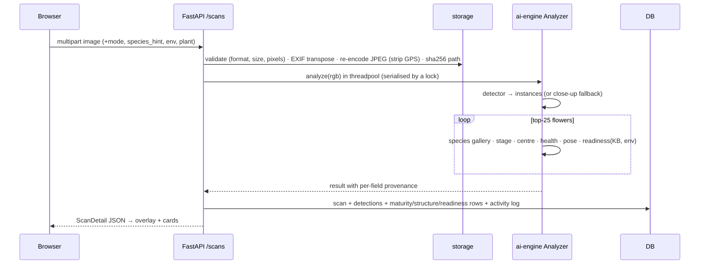
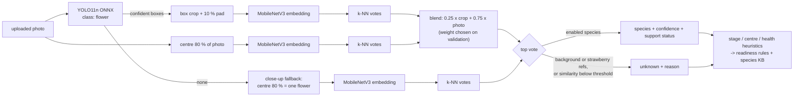
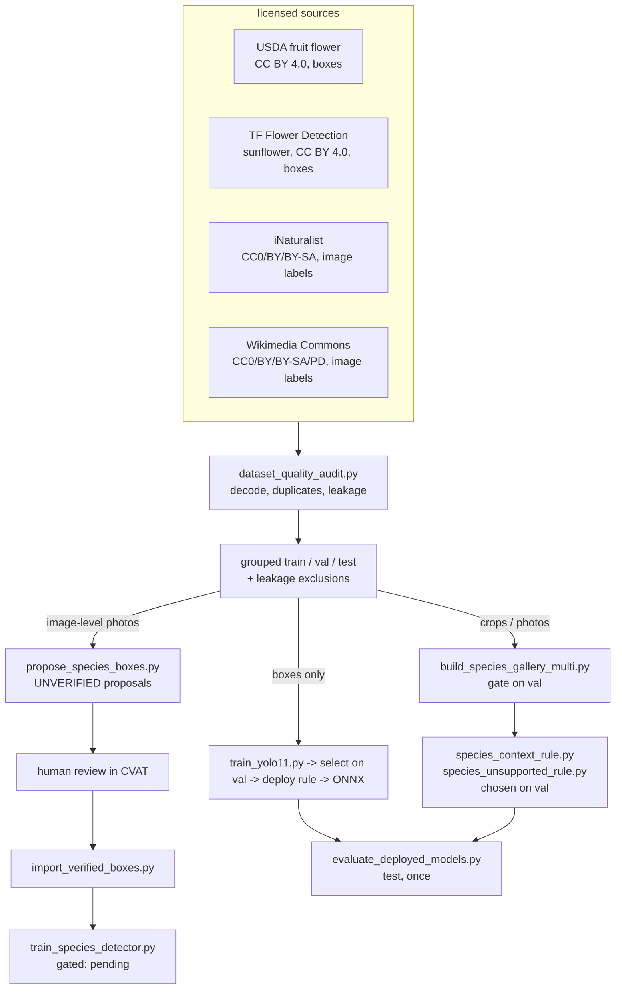

# System Architecture

## Service boundaries

| Component | Path | Depends on | Responsibility |
|---|---|---|---|
| Web app | `frontend/` | REST + WebSocket API | UI, camera capture, frame sampling, overlays, Three.js replay |
| API | `backend/app` | ai-engine, simulation, DB, file storage | Auth, validation, persistence, orchestration, reports |
| AI engine | `ai-engine/pollinex_ai` | NumPy/SciPy/OpenCV/scikit-learn | All image analysis + knowledge base + readiness rules; no web or DB code |
| Simulation | `simulation/pollinex_sim` | NumPy | Seeded particle simulation; no web or DB code |
| Training | `ai-engine/training`, `datasets/scripts` | the above (+ optional PyTorch) | Offline dataset prep, training, evaluation |

The AI engine and simulator are plain Python packages with their own tests, so they can be used from notebooks/CLI or
swapped behind the API without touching the web layer.

## Request flow: image scan

## Species decision inside the analyzer (auto mode)

## Data and training flow

## Live scanning
* Client samples one frame every *N* ms (0.5–5 s, user-adjustable). A new frame is **only sent when the previous result
  arrived** (back-pressure); skipped ticks are counted and shown.
* Transport: WebSocket `/scans/live/ws` (first message = JWT), automatic fallback to `POST /scans/live/frame`.
* Server runs the detector in **fast mode** (800 px, chosen on validation) and skips heuristics; nothing is persisted.
  "Capture & analyse" runs the full pipeline and stores a scan.

## Detector backends
`load_default_detector()` prefers `ai-engine/models/flower_yolo11n.onnx` (onnxruntime) and otherwise loads the CPU
pixel model `flower_pixel_hgb.joblib`. Both return identical `Detection` objects. `/admin/models/reload` re-reads files after
retraining.

## Concurrency & resources
* Inference runs in Starlette's threadpool; a process-wide lock serialises analyses to bound RAM on laptops.
* Simulations execute synchronously (≈50 ms) or as a background task (`?run_async=true`).
* Images ≤ 15 MB (configurable), ≤ 40 MP, downscaled to ≤ 2560 px for storage.

## Security
JWT (HS256) with per-user `token_version` (logout/role change revokes tokens); PBKDF2-SHA256 600k iterations; role checks via
dependencies; ownership checks on every record; upload validation & metadata stripping; path traversal guard on file
serving; security headers; CORS allow-list; secrets only via environment. See `SECURITY.md`.

## Extending to new species
1. Add an entry to `ai-engine/pollinex_ai/knowledge/species_kb.json` (mechanism, stages, strategy, simulation profile, evidence).
2. Add reference images through *Species recognition → Add reference* (researcher/admin).
3. Optionally collect annotated images with `datasets/annotation/` and train YOLO11.
No code changes are required for steps 1–2.
