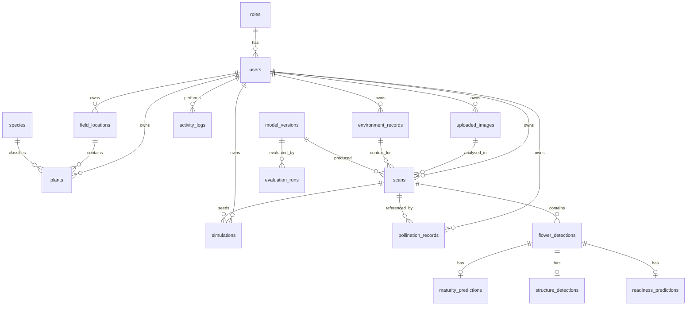

# Database Schema

Defined in `backend/app/models.py`; created by Alembic revision `0001_initial` (`backend/alembic/versions/`).
SQLite for local development, PostgreSQL in Docker/production. JSON columns hold structured model outputs; **image bytes are
never stored in the database** (files live under `UPLOAD_DIR`, addressed by SHA-256).

| Table | Key columns | Notes |
|---|---|---|
| `roles` | name (admin/researcher/user) | seeded |
| `users` | email (unique idx), password_hash, role_id, is_active, token_version | PBKDF2 hash; token_version revokes JWTs |
| `species` | id, scientific_name, primary_mechanism, knowledge (JSON) | synced from the KB at startup |
| `field_locations` | owner_id (idx), lat/lon, area | |
| `plants` | owner_id, field_id, species_id, cultivar, planted_on | flower inventory |
| `uploaded_images` | storage_path, sha256 (idx), width/height/size | deduplicated per owner |
| `environment_records` | observed_at (idx), temp/RH/rain/wind, source, source_detail (JSON) | `manual` or `open-meteo` with provider, coords, retrieval time |
| `model_versions` | (task, version) unique | auto-registered on first use |
| `scans` | owner_id (idx), created_at (idx), detection_method, flower_count, latency_ms, warnings, summary | |
| `flower_detections` | scan_id (idx), box, score, low_confidence, method, species_id (idx), species_method, pose, health | |
| `maturity_predictions` | stage (idx), score, method, uncertain, data | 1:1 detection |
| `structure_detections` | method, structure_detection_available, yellow_cluster_visible, data | 1:1 detection |
| `readiness_predictions` | category (idx), confidence, data | 1:1 detection |
| `simulations` | params, result_summary, result_path, status, sim_version | frames stored on disk as JSON |
| `pollination_records` | method, performed_at, flowers_treated, outcome_observed | user-observed real outcomes |
| `evaluation_runs` | task, dataset_id, split, metrics, report_path | seeded from `ai-engine/reports` |
| `dataset_metadata` | status, license, task_support, details | seeded from `datasets/dataset_sources.json` |
| `research_references` | evidence_type (PR/PP/DS) | seeded from `research/references.json` |
| `activity_logs` | user_id, action (idx), created_at (idx) | audit trail |

Deleting a scan cascades to its detections and predictions; deleting a field sets `field_id` to NULL on plants/scans.
Lists are paginated (`page`, `page_size`).
